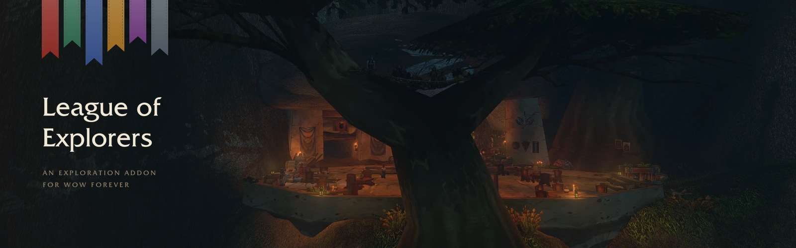

<p align="center">
  
</p>

<p align="center">
  <a href="https://ko-fi.com/vaxorus"></a>
</p>

# League of Explorers

An exploration addon for World of Warcraft Forever. It tracks the zones you explore, the rares and treasures you find and the points you earn, and shares them with your guild. It was made for the League of Explorers guild, but works in any guild or on your own.

> League of Explorers is in beta. If something's broken or confusing, please [open an issue](https://github.com/alexwaddell97/league-of-explorers-addon/issues/new).

## What it does

**Exploration.** Every zone and its areas, read from the game's own explored-map data. What you explored before installing counts toward your rank.

**Bestiary.** Every open-world rare by zone and creature type. Rares you haven't found show as silhouettes.

**Weekly hunt.** Three rares to kill and two zones to enter each week, picked for your level.

**Points and ranks.** Points go on the leaderboards. Ranks are for what you've done, and each needs a mix of zones, fully explored zones and rares. Your alts count with your main.

**Guild.** Shared finds, leaderboards and seasons, rare alerts, expeditions and bounties posted by officers, places members suggest, and your rank in guild chat and the guild window.

**Map pins.** Rares you're hunting and recent sightings, on the world map and minimap.

**Solo mode.** Turns the guild features off, for playing without a guild. It's in the settings, or `/loe solo`.

## How it works

Rares and treasures are picked up when they show on your minimap, show a nameplate, or you target or mouse over them. Forever doesn't give addons the full combat log, so a rare counts as killed when you loot it, or when you see it die after fighting it.

Finds are shared over the guild's addon channel, and only with members on the guild roster. Anyone who was offline catches up when they log in.

## Installing

Unzip it into:

```
World of Warcraft\_forever_\Interface\AddOns\LeagueOfExplorers
```

The folder must be called `LeagueOfExplorers`. If you clone this repository instead, clone it into that folder name:

```
git clone https://github.com/alexwaddell97/league-of-explorers-addon.git LeagueOfExplorers
```

## Getting started

Type `/loe` to open it, or click the minimap button. `/loe demo` gives a tour with an example guild (nothing is sent or saved).

| Command | What it does |
|---|---|
| `/loe` | Open or close the window |
| `/loe demo` | A tour of every page |
| `/loe solo` | Switch between solo and guild mode |
| `/loe alerts` | Choose which guild rare sightings pop up |
| `/loe toasts move` | Move the pop-ups |
| `/loe officers` | Show or set which guild ranks are officers |
| `/loe sync` | Guild sync status |

Guild ranks 0 and 1 are officers by default. The guild master can change this in the settings.

## Reporting a bug

[Open an issue](https://github.com/alexwaddell97/league-of-explorers-addon/issues/new) with what you were doing and any error you saw. `/loe status` shows which game features the addon can use, which helps too.

## For developers

`tools/test_logic.lua` runs the addon against a fake game API: `luatex --luaonly tools/test_logic.lua`, or any Lua 5.1+.

## Credits

The rare list in `Data/Rares.lua` comes from Polestar's Polestar Codex data (GPL-3.0), which was built from pfQuest (MIT), QuestieDB (Questie-Forever) and the game's map tables.

## A note on AI

League of Explorers is an AI assisted project.

World of Warcraft is a trademark of Blizzard Entertainment, Inc. League of Explorers isn't affiliated with or endorsed by Blizzard.

If you'd like to support development, I'm on [Ko-fi](https://ko-fi.com/vaxorus).
